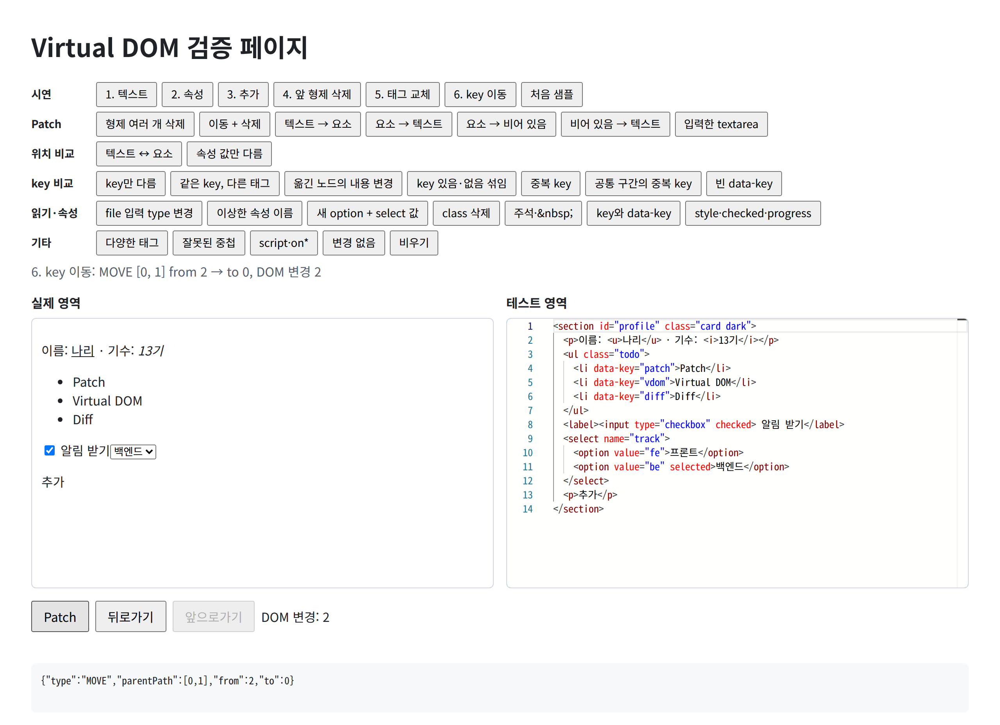
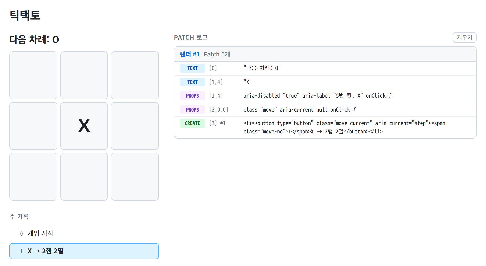
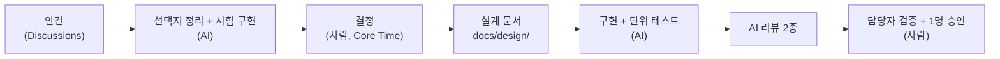

# 미니 React

TypeScript로 Virtual DOM, Diff, Patch와 함수형 컴포넌트, Hooks를 직접 만들었어요. 이 README는 기능 설명보다 **AI와 일을 어떻게 나눴는지**, **셋이 어떻게 협업했는지**, **우리 미니 React만의 차별점**을 다뤄요.

**▶ 데모:** [Virtual DOM 검증 페이지](https://nari3040.github.io/KJG-SW-AI-W11-React/) · [틱택토](https://nari3040.github.io/KJG-SW-AI-W11-React/tictactoe.html)

| 검증 페이지 | 틱택토 |
|:---:|:---:|
|  |  |

## 1. AI와 일을 나눈 방식

**원칙: AI가 선택지를 만들고, 사람이 고르고, AI가 그대로 구현하고, 사람이 검증해요.**



| 하는 일 | 어떻게 |
|---|---|
| **AI는 선택지를, 사람은 결정을** | Phase 2는 안건 18개로 쪼갰어요. 결정마다 선택지를 2개 이상 두고 장단점을 적었어요. 근거에는 "코드로 확인함 / 설계 초안의 주장 / 추론"을 따로 표시해서, 추론을 근거로 쓰지 않게 했어요 |
| **결정 전에 시험 구현** | 설계 초안을 시험용 코드로 옮겨 jsdom에서 돌려 보고, 그 결과를 보며 골랐어요 |
| **설계에 없으면 AI가 멈춰요** | AI는 `docs/design/` 문서대로만 구현하고, 빠진 내용이 있으면 멈추고 물어요. 설계 결정은 사람의 몫이에요([AGENTS.md](AGENTS.md)) |
| **AI 리뷰어를 직접 만들었어요** | 직접 만든 리뷰 액션이 PR마다 설계 문서와의 일치, 빠진 엣지 케이스, 테스트 없는 동작 변경을 봐요. push하면 바뀐 부분만 다시 보고, 반영된 지적은 스스로 닫아요. CodeRabbit이 한 번 더 봐요 |

## 2. 셋이 협업한 방식

- **약속부터 정했어요.** 코드를 쓰기 전에 Discussions에서 이슈·브랜치·PR 단위, AI로 쓴 코드의 머지 기준, AI 도구에 공유할 규칙을 정했어요. 결과는 [CONTRIBUTING.md](CONTRIBUTING.md)와 [AGENTS.md](AGENTS.md)예요.
- **공통 형식을 먼저 합의했어요.** VNode와 Patch의 모양을 [vnode-spec.md](docs/design/vnode-spec.md)에 먼저 고정해서, 셋이 다른 파일을 따로 구현해도 맞물렸어요. 형식을 정하거나 바꾸는 이슈에는 `common-format` 라벨을 붙여 따로 표시해요.
- **파일 단위로 나눴어요.** 담당마다 파일과 함수를 정하고, 누가 누구를 기다리는지 순서 그림으로 그렸어요([phase-2-plan.md](docs/design/phase-2-plan.md#순서)).
- **`main`은 보호해요.** PR로만 머지하고, CI 통과와 사람 1명 승인이 있어야 해요.

## 3. 우리 미니 React의 차별점

| 차별점 | 무엇이 다른가 |
|---|---|
| **key 비교와 LIS** | 옮겨야 하는 노드만 옮겨요. 최장 증가 부분 수열(LIS)에 든 노드는 그대로 둬요([diff.md](docs/design/diff.md#key-비교)) |
| **자식 결과 자동 캐시** | props가 같으면 자식을 다시 실행하지 않아요. React는 `React.memo`를 써야 하는 일이에요([결과 캐시](docs/design/component-hooks.md#결과-캐시)) |
| **루트 이벤트 위임** | 루트 영역에 이벤트 종류마다 리스너를 하나만 붙여요. 렌더마다 핸들러가 새 함수여도 리스너를 붙였다 떼지 않고, 요소를 만들거나 지울 때 등록 작업도 없어요([이벤트 위임](docs/design/virtual-dom.md#이벤트-위임)) |

---

## 실제 React와 다른 점

| 이 구현 | React |
|---|---|
| Diff가 Patch 목록(데이터)을 만든 뒤 따로 적용해요 | 비교 중 표시한 변경을 commit 단계에서 반영해요([Render and Commit](https://react.dev/learn/render-and-commit)) |
| `setState`마다 바로 다시 그려요 | 이벤트 안의 변경을 모아 한 번에 그려요(Batching) |
| `useEffect`를 Patch 직후 동기로 실행해요 | 대체로 화면을 그린 뒤 실행해요. 클릭 같은 상호작용으로 생긴 effect는 그리기 전에 실행될 수도 있어요([useEffect](https://react.dev/reference/react/useEffect)) |
| key 목록은 LIS로 고정할 노드를 골라요 | `lastPlacedIndex` 방식이라 이동 수가 다를 수 있어요 |

## 팀

<table align="center">
  <tr>
    <td align="center" width="33%">
      <a href="https://github.com/NARi3040"></a><br><br>
      <a href="https://github.com/NARi3040"><b>박준호</b></a><br>
      Patch, 검증 페이지, 틱택토, 문서
    </td>
    <td align="center" width="33%">
      <a href="https://github.com/dohyunrho"></a><br><br>
      <a href="https://github.com/dohyunrho"><b>노도현</b></a><br>
      Diff, 컴포넌트, Hooks
    </td>
    <td align="center" width="33%">
      <a href="https://github.com/choimoohun"></a><br><br>
      <a href="https://github.com/choimoohun"><b>최무헌</b></a><br>
      VNode, DOM 변환, 이벤트 위임
    </td>
  </tr>
</table>

## 실행하기

Node.js 26이 필요해요.

```bash
npm ci
npm test
npm run build
python3 -m http.server 8000   # http://localhost:8000/verify.html, /tictactoe.html
```

ES 모듈이라 파일을 직접 열면(`file://`) 동작하지 않아서 로컬 서버로 열어요. 검증 페이지의 Monaco 에디터는 CDN에서 불러오고, 불러오지 못하면 textarea로 동작해요. Monaco는 과제 제한(HTML, CSS, TypeScript만)의 유일한 예외예요.

## 문서

| 문서 | 내용 |
|---|---|
| [docs/PLANNING.md](./docs/PLANNING.md) | 과제 요구사항 |
| [docs/design/vnode-spec.md](./docs/design/vnode-spec.md) | VNode·Patch 공통 형식과 설계 문서 지도 |
| [docs/design/phase-2-plan.md](./docs/design/phase-2-plan.md) | Phase 2 결정 반영표, 담당, 순서 |
| [docs/design/verify-page.md](./docs/design/verify-page.md) | 검증 페이지와 시연 시나리오 |
| [docs/design/component-hooks.md](./docs/design/component-hooks.md) | `FunctionComponent`, 결과 캐시, Hooks |
| [CONTRIBUTING.md](./CONTRIBUTING.md) | 협업 규칙과 AI 리뷰 |
| [AGENTS.md](./AGENTS.md) | AI 도구가 따를 규칙 |
