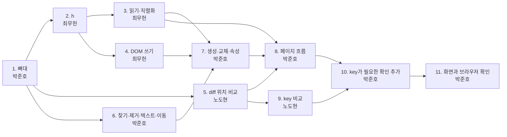

# Phase 1 구현 계획

> 이 문서를 읽으면 누가 어떤 함수를 어떤 순서로 만들고, 다른 담당의 어떤 함수를 기다려야 하며, 무엇으로 완료를 확인하는지 알 수 있어요.

| 항목 | 내용 |
|---|---|
| 상태 | 공개 함수의 이름과 시그니처는 담당 사이의 약속이에요. 내부 함수의 이름과 구성은 제안이라 담당이 바꿔도 돼요 |
| 다루는 요구사항 | R1-1~R1-7, R3-2, R3-3 |
| 관련 이슈 | #27, #4, #5, #6, #7 |

이 문서는 함수의 분담과 순서만 다뤄요. 동작 규칙은 각 표 위에 링크한 문서를 봐 주세요. 타입(`VNode`, `Props`, `Key`, `Patch`, `Path`)은 [vnode-spec.md](vnode-spec.md)에 있어요.

## 담당

| 담당 | 이슈 | 파일 |
|---|---|---|
| 최무헌 (`choimoohun`) | #4 | `src/vnode.ts`, `src/dom.ts` |
| 노도현 (`dohyunrho`) | #5 | `src/diff.ts` |
| 박준호 (`NARi3040`) | #27, #6, #7 | 뼈대, `src/patch.ts`, `src/app.ts`, 검증 페이지 |

## 뼈대

다른 담당이 늦어도 각자 테스트할 수 있게, 구현 전에 뼈대 PR을 먼저 올려요.

- `src/vnode.ts`에 [타입과 상수](vnode-spec.md#vnode)를 실제로 넣어요.
- `src/vnode.ts`, `src/dom.ts`, `src/diff.ts`, `src/patch.ts`, `src/app.ts`에 이 문서의 **공개** 함수를 시그니처대로 선언하고, 본문은 `throw new Error("미구현")`로 둬요. 내부 함수는 넣지 않아요.
- 아래 타입과 값도 그대로 내보내요.
- `src/index.ts`는 모든 모듈을 `export *`로 내보내고, 지금의 빈 `export {}`와 `shortcut:` 주석을 지워요.

| 파일 | 내보낼 선언 |
|---|---|
| `src/vnode.ts` | `export type Child = VNode \| string \| number \| boolean \| null \| undefined \| Child[];` |
| `src/app.ts` | `export type Editor = { value: string };` |
| `src/app.ts` | `export const history: { stack: VNode[]; index: number } = { stack: [], index: -1 };` |

각자 자기 함수의 본문만 채워요. 아직 구현되지 않은 함수에 기대는 테스트는 올리지 않아요. "미구현" 오류로 CI가 실패해요. 테스트 데이터는 손으로 쓴 VNode, Patch 목록, `innerHTML`로 만들어요. 규칙 문서의 테스트 중 아직 구현되지 않은 함수가 필요한 줄은 그 함수가 머지된 뒤 추가해요.

## 순서

| 단계 | 담당 | 내용 | 먼저 있어야 하는 것 |
|---|---|---|---|
| 1 | 박준호 | [뼈대](#뼈대) PR (#27) | 이 문서의 PR 머지. **모두가 기다려요. 가장 먼저 올려요** |
| 2 | 최무헌 | `createTextVNode`, `h` | 1 |
| 3 | 최무헌 | DOM 읽기, HTML 직렬화 | 2 |
| 4 | 최무헌 | `setProp`, `applyProps`, `createDOM`, `mountArea` | 2 |
| 5 | 노도현 | `diff` 위치 비교까지. `lis`와 key 비교 제외 | 1. 손으로 쓴 VNode로 시작하고, `h`가 구현되면 써도 돼요 |
| 6 | 박준호 | `resolve`, `locateTargets`, `REMOVE`·`TEXT`·`MOVE` 적용 | 1. 테스트용 DOM은 `innerHTML`로 만들어요 |
| 7 | 박준호 | `CREATE`·`REPLACE`·`PROPS` 적용, `formatPatches` | 4, 6, 그리고 `toHTML`(3) |
| 8 | 박준호 | `src/app.ts` 전체. [시연 시나리오](verify-page.md#시연-시나리오)는 1–5단계와 그 뒤로가기까지 확인해요 | 3, 4, 5, 7. key 비교 전이라 시나리오 6단계는 `MOVE`가 아니라 `REPLACE` 3개가 나와요 |
| 9 | 노도현 | `lis`, `diffKeyed`와 내부 함수 | 5 |
| 10 | 박준호 | 시나리오 6–7단계와 [무작위 테스트](patch.md#테스트) 추가 | 8, 9 |
| 11 | 박준호 | 시작 코드, 화면, 브라우저 기능 테스트 | 10. **페이지 경로와 화면 배치를 정한 뒤에 해요** |

각 단계가 끝나면 AGENTS.md의 검사를 통과한 뒤 다음 단계로 넘어가요.

## 최무헌: `src/vnode.ts`

규칙: [virtual-dom.md의 `h`](virtual-dom.md#h). `Child`는 [뼈대](#뼈대)에 있어요.

| 함수 | 공개 | 하는 일 | 완료 확인 |
|---|---|---|---|
| `createTextVNode(text: string \| number): VNode` | 공개 | 텍스트 VNode를 만들어요 | `createTextVNode(1).children`이 `"1"`, `flags`가 `TEXT` |
| `normalizeChildren(raw: Child[]): { children: VNode[] \| string \| null; childFlag: number }` | 내부 | 평탄화, 버리기, 이웃한 텍스트 합치기, 텍스트 감싸기 | `["a"]` → `"a"`와 `TEXT_CHILDREN`. `["a", 1]` → `"a1"`. `[]` → `null`과 0 |
| `normalizeProps(props: Props \| null, isElement: boolean): { props: Props \| null; key: Key \| null }` | 내부 | `key` 분리, 요소일 때만 `className` → `class`, 빈 객체 → `null` | `{ key: "a", className: "x" }`, `true` → `{ class: "x" }`와 `"a"`. 같은 입력, `false` → `{ className: "x" }`와 `"a"`. `{ key: 0 }` → `null`과 `0` |
| `h(type: string \| Component, props?: Props \| null, ...children: Child[]): VNode` | 공개 | 위 둘을 불러 VNode를 조립하고 `flags`를 계산해요 | [virtual-dom.md의 호출 표](virtual-dom.md#h) 전부 |

## 최무헌: `src/dom.ts`

### DOM 읽기

규칙: [virtual-dom.md의 DOM → VNode](virtual-dom.md#dom--vnode).

| 함수 | 공개 | 하는 일 | 완료 확인 |
|---|---|---|---|
| `readProps(el: Element): Props \| null` | 내부 | `on*`, `key` 속성 버리기. 속성을 다 읽은 뒤 `data-key`가 있으면 `key`로도 복사 | `<li data-key="a" onclick="f()">` → `{ "data-key": "a", key: "a" }`. `<li key="x">` → `null` |
| `readChildren(parent: ParentNode, keepWs: boolean): (VNode \| string)[]` | 내부 | 주석·`script` 버리기 → 이웃한 텍스트 합치기 → 줄바꿈이 있는 공백뿐인 텍스트 버리기(HTML 공백만). 요소는 `toVNode` | `
\n
`의 결과는 `[]`, `
 
`의 결과는 `[" "]`, `<pre>\n\n</pre>`의 결과는 `["\n"]`(`keepWs` 적용), `
&nbsp;
`의 결과는 `["\u00a0"]`, `
a<!--x-->\n<b>b</b>
`의 결과는 `["a\n", b]` |
| `toVNode(el: Element, keepWs: boolean): VNode` | 내부 | 태그 이름, `readProps`, `readChildren`을 `h`에 넘겨요 | `pre`, `textarea` 안에서 `keepWs`가 켜져요 |
| `readArea(parent: ParentNode): VNode` | 공개 | 자식을 `div.vdom-root`로 감싸요 | 빈 영역의 `children`이 `null` |
| `fromHTML(html: string): VNode` | 공개 | `template`으로 파싱하고 `readArea`에 넘겨요 | [virtual-dom.md의 입력·출력 표](virtual-dom.md#dom--vnode) 네 줄 |

### HTML 직렬화

규칙: [virtual-dom.md의 VNode → HTML](virtual-dom.md#vnode--html).

| 함수 | 공개 | 하는 일 | 완료 확인 |
|---|---|---|---|
| `esc(s: string): string` | 내부 | `&`, `<`, `>`, `"` 이스케이프 | `"a<b"` → `"a&lt;b"` |
| `openTag(v: VNode): string` | 내부 | 여는 태그와 속성 문자열 | `h("input", { checked: "" })` → `<input checked>` |
| `toHTML(v: VNode): string` | 공개 | 한 줄 HTML. 원문 텍스트 요소는 이스케이프하지 않아요 | ``이 그대로. 내용이 `"\nabc"`인 `pre`는 `<pre>\n\nabc</pre>` |
| `canIndent(v: VNode): boolean` | 내부 | 줄을 바꿔도 내용이 같은지 판단해요 | 텍스트가 섞이거나 `pre`, `textarea`면 `false`. `false`면 서브트리 전체를 `toHTML` 한 줄로 써서 안쪽 요소도 들여쓰지 않아요 |
| `toPrettyHTML(v: VNode, depth: number): string` | 내부 | 들여쓴 HTML | `depth`마다 두 칸 |
| `sourceOf(root: VNode): string` | 공개 | 루트 안쪽의 textarea용 소스 | [virtual-dom.md의 예시](virtual-dom.md#vnode--html). [무작위 입력](virtual-dom.md#무작위-입력)에서 `fromHTML(sourceOf(v))`가 `v`와 같음 |

### DOM 쓰기

규칙: [virtual-dom.md의 VNode → DOM](virtual-dom.md#vnode--dom), [`setProp`](virtual-dom.md#setprop).

| 함수 | 공개 | 하는 일 | 완료 확인 |
|---|---|---|---|
| `setStyle(el: Element, next: PropValue): void` | 내부 | `setProp`의 `style` 처리 | 문자열은 `cssText`, 객체는 `el.style`에 복사 |
| `setProp(el: Element, key: string, next: PropValue): void` | 공개 | 속성 하나 반영. Phase 1에서 `on*`은 아무것도 하지 않아요 | `class` 삭제 후 빈 `class` 없음. `checked: ""`면 프로퍼티가 `true`. `<output value="x"><b>y</b></output>`의 자식이 남음 |
| `applyProps(el: Element, props: Props): void` | 공개 | `value` 외 속성을 먼저, `value`를 마지막에 `setProp`해요 | `range`의 `min`, `max`, `value`에서 값이 잘리지 않음 |
| `createDOM(v: VNode): Node` | 공개 | 새 DOM을 만들어요. 자식 다음에 `applyProps` | 컴포넌트 VNode면 오류. `select`의 `value`가 반영됨 |
| `mountArea(container: Element, vnode: VNode): void` | 공개 | 영역을 비우고 새로 그려요 | 영역의 자식이 루트 하나 |

`createDOM`과 박준호의 속성 단계가 같은 순서를 쓰므로 `applyProps`로 합쳐요. `createDOM`이 `flags`로 자식 종류를 판단하므로 텍스트 VNode는 `createTextNode`로 바로 돌려줘요.

## 노도현: `src/diff.ts`

`src/diff.ts`는 DOM을 쓰지 않아요. 테스트에서도 `jsdom`을 쓰지 않아요.

### 위치 비교까지 (단계 5)

규칙: [diff.md의 노드 비교](diff.md#노드-비교), [자식 비교](diff.md#자식-비교-9가지-조합), [위치 비교](diff.md#위치-비교). `path`는 하나의 배열을 `push`와 `pop`으로 재사용해요.

| 함수 | 공개 | 하는 일 | 완료 확인 |
|---|---|---|---|
| `isSame(a: VNode, b: VNode): boolean` | 내부 | `type`과 `key`가 모두 같은지 비교해요 | 같은 태그에 다른 key면 `false` |
| `hasKey(list: VNode[]): boolean` | 내부 | key가 하나라도 있는지 봐요. `key != null`로 판단해요 | 테스트는 단계 9에서 `diff` 결과로 해요. 이 단계에서는 `diffChildren`이 부르지 않아요. key가 `0`이나 `""`인 노드가 있으면 `true`, key가 모두 `null`이면 `false` |
| `diffProps(oldP: Props \| null, newP: Props \| null): { set: Props; remove: string[] } \| null` | 내부 | 바뀐 속성과 지운 속성을 구해요 | 같으면 `null`. `null`, `{ a: "1" }` → `set: { a: "1" }`, `remove: []` |
| `diffUnkeyed(c1: VNode[], c2: VNode[], path: Path, out: Patch[]): void` | 내부 | 같은 위치끼리 비교, 남는 쪽은 `REMOVE` 또는 `CREATE` | `REMOVE`는 뒤 인덱스부터 |
| `diffChildren(o: VNode, n: VNode, path: Path, out: Patch[]): void` | 내부 | 9가지 조합으로 나눠요 | [조합 표](diff.md#자식-비교-9가지-조합) 아홉 칸 |
| `diffNode(o: VNode, n: VNode, path: Path, out: Patch[]): void` | 내부 | 같은 객체 → 교체 → 텍스트 → 자식 → 속성 순서 | 자식 Patch가 `PROPS`보다 먼저 |
| `diff(oldV: VNode, newV: VNode): Patch[]` | 공개 | 빈 배열을 만들어 `diffNode`를 불러요 | 변경 없으면 `[]`. [위치 비교 예시](vnode-spec.md#전체-예시)와 정확히 같음 |

표 밖의 내부 보조 함수: `removeRange`(자식 구간을 뒤 인덱스부터 `REMOVE`), `createRange`(새 자식 구간을 오름차순으로 `CREATE`), `pushText`(`TEXT` 추가), `textOf`(VNode의 텍스트 꺼내기). `removeRange`와 `createRange`는 단계 9의 key 비교 3단계에서도 써요.

### key 비교 (단계 9)

규칙: [diff.md의 key 비교](diff.md#key-비교), [LIS](diff.md#lis). 이 단계 전까지 `diffChildren`은 배열끼리 항상 `diffUnkeyed`를 불러요.

Phase 1에 포함하되 마지막에 구현해요. Notion 결정 F는 "key 비교를 Phase 1에 넣되 구현 순서상 마지막에 한다"예요. 샘플 목록에 `data-key`가 있어 `MOVE`를 시연할 수 있고, 빼도 Phase 1은 동작해요. DOM에서 읽은 VNode는 `data-key`가 없으면 key가 없기 때문이에요.

**축소 구현:** 단계 9를 시작하기 전에 `src/diff.ts` 담당자(노도현)가 남은 일정을 보고 축소 여부를 정하고 PR에 적어요. 축소하면 key 비교의 4–5단계를 빼고, 1–3단계 뒤에 남은 구간을 아래처럼 처리해요.

- 남은 이전 구간을 뒤 인덱스부터 `REMOVE`하고, 남은 새 구간을 새 인덱스 오름차순으로 `CREATE`해요. `REMOVE`를 모두 낸 뒤 `CREATE`를 내요.
- `keyIndexMap`, `findMatch`, `emitPlacement`는 만들지 않아요. `lis`는 공개 함수이고 다른 함수에 기대지 않는 순수 함수라서, 축소해도 구현하고 [테스트](diff.md#테스트)해요.
- 결과 DOM 구조는 같고 DOM 변경만 늘어요. 다만 남은 구간의 노드는 새로 만들어지므로 DOM 객체가 바뀌고, 사용자가 실제 영역에서 바꾼 폼 상태(체크, 입력값)는 VNode 값으로 돌아가요. 아래 기대값은 문서로 계산했고 실행하지 않았어요.

| 대상 | 원래 기대값 | 축소하면 |
|---|---|---|
| [key 비교 예시](vnode-spec.md#전체-예시) | `MOVE` (4 → 2), `CREATE` (5) | `REMOVE [0, 4]`, `[0, 3]`, `[0, 2]`, `CREATE [0]` `index: 2`(e), `3`(c), `4`(d), `5`(h) |
| [시연 시나리오](verify-page.md#시연-시나리오) 6단계 | `MOVE [0, 1]` `from: 2`, `to: 0`, DOM 변경 2 | `REMOVE [0, 1, 2]`, `[0, 1, 1]`, `[0, 1, 0]`, `CREATE [0, 1]` `index: 0`, `1`, `2`, DOM 변경 6 |

| 함수 | 공개 | 하는 일 | 완료 확인 |
|---|---|---|---|
| `lis(arr: number[]): number[]` | 공개 | 최장 증가 부분수열의 인덱스. 값 0은 제외해요 | `lis([5, 3, 4, 0])` → `[1, 2]` |
| `keyIndexMap(c2: VNode[], start: number, end: number): Map<Key, number>` | 내부 | 4단계의 key → 새 인덱스 맵. 중복 key는 경고하고 먼저 나온 인덱스를 남겨요 | `e c d h`, `start: 2` → `{ e: 2, c: 3, d: 4, h: 5 }`. `x x`, `start: 0` → `{ x: 0 }`, 경고 1번 |
| `findMatch(prev: VNode, c2: VNode[], start: number, end: number, keyToNew: Map<Key, number>, newToOld: number[]): number \| undefined` | 내부 | 이전 노드의 새 위치를 찾아요. 없거나 찼거나 `type`이 다르면 `undefined` | key 없는 노드는 같은 타입의 빈자리를 앞에서부터 찾음 |
| `emitPlacement(c2: VNode[], start: number, newToOld: number[], moved: boolean, path: Path, out: Patch[]): void` | 내부 | 5단계. 새 인덱스 오름차순으로 `MOVE`, `CREATE`를 내요 | `[5, 3, 4, 0]`, `start: 2` → `MOVE (4 → 2)`, `CREATE (5)` |
| `diffKeyed(c1: VNode[], c2: VNode[], path: Path, out: Patch[]): void` | 내부 | 1–3단계를 직접 하고 4–5단계에서 위 함수를 불러요 | [key 비교 예시](vnode-spec.md#전체-예시)와 정확히 같음 |

## 박준호: `src/patch.ts`

규칙: [patch.md의 네 단계](patch.md#applypatches의-네-단계). `Target`은 `{ parent: Node | null; node: Node | null }`이고, Patch와 같은 인덱스로 찾아 둔 대상이에요.

| 함수 | 공개 | 하는 일 | 완료 확인 |
|---|---|---|---|
| `resolve(container: Node, path: Path): Node` | 공개 | 경로로 노드를 찾아요. 노드가 없으면 `path`를 담은 `Error`를 던져요 | `[]`는 `container.firstChild`. 어긋난 경로는 `Error` |
| `locateTargets(container: Node, patches: Patch[]): Target[]` | 내부 | 1단계. 아무것도 고치지 않고 대상을 찾아요 | 호출 전후 `innerHTML`이 같음 |
| `applyStructure(patches: Patch[], targets: Target[]): void` | 내부 | 2단계. `REMOVE`, `REPLACE`, `TEXT`, `MOVE` 떼기. `textarea`의 `TEXT`는 `.value`에도 대입해요 | 형제 여러 개 동시 삭제. 입력한 `textarea`에 `TEXT` 적용 후 `.value`가 새 값 |
| `applyInsertions(patches: Patch[], targets: Target[]): void` | 내부 | 3단계. `CREATE`, `MOVE`를 Patch 순서대로 넣어요 | 이동한 노드가 같은 객체(`===`) |
| `applyPropPatches(patches: Patch[], targets: Target[]): void` | 내부 | 4단계. `remove`를 `setProp(el, k, null)`로 지우고 `applyProps(el, set)`를 불러요 | 새 `option`과 함께 `select` 값 변경 |
| `applyPatches(container: Node, patches: Patch[]): void` | 공개 | 위 네 함수를 차례로 불러요. 예외를 잡지 않아요 | 손으로 쓴 Patch로 형제 삭제와 이동 후 DOM이 기대와 같음. 무작위 테스트는 단계 10이에요 |
| `formatPatches(patches: Patch[]): string` | 공개 | `node`는 `toHTML`로, 함수는 `"ƒ"`로 바꾼 JSON | [patch.md의 예시](patch.md#함수)와 같음 |

## 박준호: `src/app.ts`

규칙: [verify-page.md의 함수](verify-page.md#함수), [Patch 실패](verify-page.md#patch-실패). `Editor`와 `history`는 [뼈대](#뼈대)에 있어요.

| 함수 | 공개 | 하는 일 | 완료 확인 |
|---|---|---|---|
| `load(real: Element, editor: Editor): void` | 공개 | 읽기, 새로 그리기, textarea 채우기, `history` 초기화 | `index`가 0, `stack` 길이가 1 |
| `applyOrRestore(real: Element, cur: VNode, patches: Patch[]): void` | 내부 | `applyPatches`가 실패하면 `mountArea(real, cur)` 후 다시 던져요 | 복구 후 자가 검사 통과 |
| `onPatch(real: Element, editor: Editor): Patch[]` | 공개 | `fromHTML`, `diff`, `applyOrRestore`, `history` 추가, textarea 다시 채우기 | 시나리오 1–5단계(단계 8), 6단계(단계 10). 실패 시 `history`, textarea 그대로 |
| `canGo(delta: -1 \| 1): boolean` | 공개 | 그 방향으로 갈 수 있는지 봐요 | 로드 직후 `canGo(-1)`이 `false` |
| `go(real: Element, editor: Editor, delta: -1 \| 1): Patch[] \| null` | 공개 | `diff`, `applyOrRestore`, textarea, `index` 이동 | 5단계까지의 뒤로가기(단계 8), 시나리오 7단계(단계 10) |
| `countMutations<T>(target: Node, fn: () => T): { result: T; mutations: number }` | 공개 | [감시 옵션](verify-page.md#함수)으로 `takeRecords`를 세고 `finally`로 `disconnect`해요 | 시나리오의 DOM 변경 횟수 |

## 박준호: 검증 페이지 (단계 11)

규칙: [verify-page.md의 화면](verify-page.md#화면), [Patch 실패](verify-page.md#patch-실패). 페이지 경로와 화면 배치는 2026-11-09에 담당자(박준호)가 정했어요.

| 파일 | 하는 일 |
|---|---|
| `verify.html` | 저장소 루트의 페이지예요. [샘플 HTML](verify-page.md#샘플-html)을 담은 실제 영역과 화면 요소, CSS를 두고 `./dist/verify-page.js`의 `start(document)`를 불러요 |
| `src/verify-page.ts` | 시작 코드예요. 요소를 찾아 버튼에 연결하고 결과와 오류를 화면에 써요. `src/index.ts`에서 내보내지 않아요 |

| 함수 | 공개 | 하는 일 | 완료 확인 |
|---|---|---|---|
| `start(doc: Document): void` | 공개 | 요소를 찾고, `load` 후 버튼 상태를 맞추고, 세 버튼에 `click` 핸들러를 달아요 | `verify.html`로 만든 문서에서 로드 직후 textarea가 `sourceOf(v0)`이고 두 이동 버튼이 비활성 |
| `byId(doc: Document, id: string, tag: string): Element` | 내부 | `id`로 찾고 `tagName`이 맞는지 확인해요. 없거나 다르면 `id`를 담은 `Error`를 던져요 | `#log`가 없는 문서에서 `start`가 `#log`를 담은 `Error`를 던짐 |
| `run(action: () => Patch[] \| null): void` | 내부 | `countMutations(real, action)`로 실행해 로그와 변경 횟수를 쓰고 오류를 지워요. 예외가 나면 메시지만 `#error`에 써요. 끝나면 `canGo`로 버튼 상태를 맞춰요 | Patch 후 로그가 Patch당 한 줄([verify-page.md의 화면](verify-page.md#화면)), 변경 횟수가 `1`. Patch 5개면 5줄, 없으면 `변경 없음`. 실패 후 `#error`에 메시지, 다음 성공에서 지워짐 |

## 담당 사이의 약속

바꾸면 받는 쪽 구현이 깨져요. 시그니처를 바꾸려면 받는 담당에게 먼저 알려요.

| 주는 담당 | 함수 | 받는 담당 |
|---|---|---|
| 뼈대 PR | `src/vnode.ts`의 타입과 상수, 공개 함수의 시그니처 | 모두 |
| 최무헌 | `h` | 노도현(테스트), 박준호(테스트) |
| 최무헌 | `createDOM`, `setProp`, `applyProps`, `toHTML` | 박준호(`src/patch.ts`) |
| 모두 | [DOM 전역 규칙](virtual-dom.md#dom-전역-규칙) | 모두(테스트) |
| 최무헌 | `readArea`, `fromHTML`, `sourceOf`, `mountArea` | 박준호(`src/app.ts`) |
| 노도현 | `diff` | 박준호(`src/app.ts`) |

Patch의 형식과 순서는 [vnode-spec.md의 약속](vnode-spec.md#diff와-patch-사이의-약속)이 노도현과 박준호 사이의 계약이에요.

## 미정

| 항목 | 영향 |
|---|---|
| ~~페이지 경로와 시작 코드, 화면 배치와 요소 `id`~~ | ~~단계 11~~ 2026-11-09 결정: [검증 페이지](#박준호-검증-페이지-단계-11) |
| #4~#7을 세부 이슈로 나눌지 | 이슈의 할 일에 "세부 이슈로 나누기"가 있어요. 위 단계를 그대로 쓸 수 있어요 |
