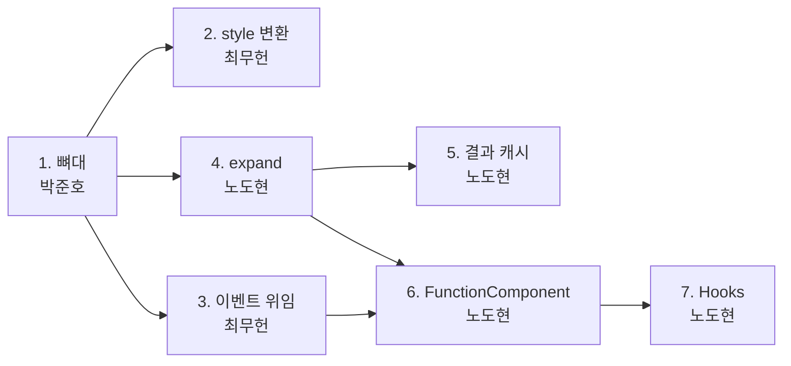

# Phase 2 구현 계획

> 이 문서를 읽으면 Phase 2에서 누가 어떤 함수를 어떤 순서로 만들고, 다른 담당의 어떤 함수를 기다려야 하며, 무엇으로 완료를 확인하는지 알 수 있어요.

| 항목 | 내용 |
|---|---|
| 상태 | **담당과 일부 결정은 제안이에요.** 팀이 확인하면 이 줄을 고쳐요([미정](#미정)). 공개 함수의 이름과 시그니처는 담당 사이의 약속이에요. 내부 함수의 이름과 구성은 제안이라 담당이 바꿔도 돼요 |
| 다루는 요구사항 | R2-1~R2-6, R3-2 |
| 관련 이슈 | #65, #8, #9 |
| 결정 원본 | Notion "Phase 2 정해야 할 것 (안건 정리본)" (2026-11-11 확인), Discussion #55 |

이 문서는 함수의 분담과 순서만 다뤄요. 동작 규칙은 각 표 위에 링크한 문서를 봐 주세요. 안건 번호(`4-1 C` 등)는 Notion 정리본의 번호예요.

테스트 페이지(지뢰찾기, R3-1, R3-3, #10)는 이 문서에서 다루지 않아요. 엔진이 끝난 뒤 따로 계획해요([미정](#미정)).

## 결정 반영표

| 안건 | 결정 | 반영한 곳 |
|---|---|---|
| 1 props 타입 | A: `h` 오버로드. 컴포넌트 VNode의 `props` 뜻이 바뀌어 #65에 `common-format` 라벨을 달았어요 | [virtual-dom.md의 `h`](virtual-dom.md#h), [vnode-spec.md의 VNode](vnode-spec.md#vnode) |
| 2 컴포넌트 실행 구조 | C: 매 렌더 전체를 펼치되 자식 결과를 캐시 | [component-hooks.md의 `expand`](component-hooks.md#expand) |
| 3 Hook 저장 | A: 배열과 인덱스 | [component-hooks.md의 `FunctionComponent`](component-hooks.md#functioncomponent) |
| 4-1 이벤트 | C: 루트 컨테이너에 위임 | [virtual-dom.md의 이벤트 위임](virtual-dom.md#이벤트-위임) |
| 4-2 style | C: `h`에서 문자열로 변환 | [virtual-dom.md의 `h`](virtual-dom.md#h) |
| 5-1 렌더 시점 | A: `setState`마다 즉시 동기 렌더 | [component-hooks.md의 Hooks](component-hooks.md#hooks) |
| 5-2, 5-3, 5-4 | A: 같은 값 건너뛰기, 함수형 업데이트, setter 고정 | 같은 곳 |
| 7-1~7-4 | A: Patch 직후 동기 실행, 다시 실행 전 cleanup, `Object.is`, 생략은 매 렌더·`[]`는 첫 렌더 | 같은 곳 |
| 8-1, 8-2 | A: 생략은 매번 계산, `useEffect`와 같은 비교 | 같은 곳 |
| 10 부모와 자식 | B: setter를 props로 직접 전달 | [component-hooks.md의 결과 캐시](component-hooks.md#결과-캐시), [테스트](component-hooks.md#테스트)의 "자식에 setter 전달" |
| 6, 9, 11, 13, 5-5, 8-3 | 제외 | [component-hooks.md의 제외한 안건](component-hooks.md#제외한-안건) |
| 12-1, 12-2, 15, 18-1, 18-2 | 결정 칸이 비어 있어요. 제안을 적었어요 | [미정](#미정) |
| 14, 16, 17-1, 17-2 | 테스트 페이지 안건이라 #10에서 다뤄요 | [미정](#미정) |

## 담당 (제안)

노도현은 엔진(#8, #9), 최무헌은 기존 파일의 변경(#8 일부), 박준호는 뼈대와 공통 작업을 맡아요. 팀이 정하면 이 표를 고쳐요.

| 담당 | 이슈 | 파일 | 나눈 이유 |
|---|---|---|---|
| 최무헌 (`choimoohun`) | #8 일부 | `src/vnode.ts`, `src/dom.ts` | `h`와 `setProp`을 만든 담당이에요. 단계 2, 3은 다른 담당을 기다리지 않아요 |
| 노도현 (`dohyunrho`) | #8, #9 | `src/component.ts`, `src/hooks.ts` | 비교 로직(`diff`)을 만든 담당이에요. 결과 캐시도 이전 결과와의 비교예요. Hook은 `FunctionComponent`의 필드와 렌더 순서에 기대서 같은 사람이 맡으면 둘 사이의 약속이 한 사람 안에서 끝나요 |
| 박준호 (`NARi3040`) | #65 | 뼈대, `docs/` | 뼈대, 기존 테스트 기대값 확인, 미정 항목을 문서에 반영, PR 검증을 맡아요 |

## 뼈대

Phase 1과 같은 이유로, 구현 전에 뼈대 PR을 먼저 올려요.

- 새 파일 `src/component.ts`, `src/hooks.ts`에 이 문서의 **공개** 함수를 시그니처대로 선언하고, 본문은 `throw new Error("미구현")`로 둬요. 내부 함수는 넣지 않아요.
- `src/dom.ts`에 `listen`을 같은 방식으로 선언해요.
- `src/vnode.ts`의 `h`에 [오버로드 시그니처](virtual-dom.md#h)만 추가해요. 본문은 그대로 둬요.
- 아래 타입과 클래스 필드를 그대로 내보내요.
- `src/index.ts`에 `export * from "./component.ts"`와 `export * from "./hooks.ts"`를 추가해요.

| 파일 | 내보낼 선언 |
|---|---|
| `src/component.ts` | `export type Memo = { type: Component; props: Props \| null; children: VNode[] \| string \| null; result: VNode };` |
| `src/component.ts` | `FunctionComponent` 클래스와 [필드](component-hooks.md#functioncomponent). 메서드 본문은 `throw new Error("미구현")` |
| `src/hooks.ts` | `export type SetState<T> = (next: T \| ((prev: T) => T)) => void;` |

각자 자기 함수의 본문만 채워요. 아직 구현되지 않은 함수에 기대는 테스트는 올리지 않아요. 테스트 데이터는 `h`와 `innerHTML`로 만들어요.

## 순서

| 단계 | 담당 | 내용 | 먼저 있어야 하는 것 |
|---|---|---|---|
| 1 | 박준호 | [뼈대](#뼈대) PR | 이 문서의 PR 머지. **모두가 기다려요. 가장 먼저 올려요** |
| 2 | 최무헌 | `h`의 style 문자열 변환 | 1. [기존 테스트 기대값](#기존-테스트의-기대값-변경)을 담당자가 확인한 뒤 바꿔요 |
| 3 | 최무헌 | `setProp`의 `on*` 처리, `listen` | 1 |
| 4 | 노도현 | `expand`. 캐시 없이 | 1 |
| 5 | 노도현 | `expand`의 결과 캐시 | 4 |
| 6 | 노도현 | `FunctionComponent`, `createRoot` | 3, 4. 5가 없어도 돼요. 캐시 없이 동작해요. Hook이 필요한 확인은 단계 7에서 해요 |
| 7 | 노도현 | `useState`, `useEffect`, `useMemo`. effect 안 `setState`처럼 `runEffects`와 Hook이 함께 필요한 확인도 여기서 해요 | 6 |

각 단계가 끝나면 AGENTS.md의 검사를 통과한 뒤 다음 단계로 넘어가요.

## 최무헌: `src/vnode.ts`

규칙: [virtual-dom.md의 `h`](virtual-dom.md#h).

| 함수 | 공개 | 하는 일 | 완료 확인 |
|---|---|---|---|
| `h` (오버로드) | 공개 | 뼈대에서 시그니처만 추가해요. 단계 2에서 바꾸는 본문은 없어요 | `h(TodoList, { items: ["a"] })`, `h(Input, { onAdd: (t: string) => {} })`가 타입 검사를 통과. `h(TodoList, { wrong: 1 })`, `h("div", { items: [1] })`는 타입 오류(테스트 파일에 `// @ts-expect-error`로 둬요) |
| `styleText(style: Record<string, string>): string` | 내부 | 객체 style을 `cssText` 문자열로 바꿔요 | `{ color: "red", fontSize: "12px" }` → `"color: red; font-size: 12px"`. `{ "--gap": "4px" }` → `"--gap: 4px"`. `{ color: "" }` → `""` |
| `normalizeProps` (수정) | 내부 | 요소일 때만 `style` 객체를 `styleText`로 바꿔요. 결과가 빈 문자열이면 `style`을 지워요 | `h("p", { style: { color: "red" } }).props`가 `{ style: "color: red" }`. `h(Item, { style: { color: "red" } }).props.style`은 같은 객체. `h("p", { style: {} }).props`가 `null` |

### 기존 테스트의 기대값 변경

4-2 C를 구현하면 아래 기존 테스트가 실패해요. 결정한 동작대로 기대값을 바꾸는 것이지만, AGENTS.md에 따라 담당자에게 먼저 확인받아요.

| 테스트 | 지금 기대값 | 바뀔 기대값 |
|---|---|---|
| `src/vnode.test.ts` "입력 props를 변경하지 않고 나머지 값과 참조를 보존한다" | `node.props.style`이 입력한 객체와 같은 참조 | `"color: red"`. 입력 `props`를 바꾸지 않는다는 검사는 그대로 |
| `src/dom.test.ts` "불리언·빈 속성은 이름만 쓰고 직렬화할 수 없는 속성은 생략한다" | `style: { color: "red" }`가 출력에서 빠짐 | `style="color: red"`가 출력에 들어감. 객체 속성 생략은 다른 객체 값으로 확인 |
| `src/diff.test.ts` "!==로 비교해요: 내용이 같아도 다른 style 객체면 set" | 다른 객체면 `PROPS` | `[]`. 이름도 "내용이 같은 style 객체는 같은 문자열이 돼요"로 바꿔요 |

## 최무헌: `src/dom.ts`

규칙: [virtual-dom.md의 이벤트 위임](virtual-dom.md#이벤트-위임).

| 함수 | 공개 | 하는 일 | 완료 확인 |
|---|---|---|---|
| `setProp` (수정) | 공개 | `on*`에 함수가 오면 요소별 핸들러 맵에 넣고, 아니면 그 이름을 지워요. 속성과 요소 리스너는 여전히 붙이지 않아요 | 기존 `on*` 테스트 두 개가 그대로 통과(요소의 `addEventListener` 0회) |
| `listen(container: Element): void` | 공개 | 컨테이너에 위임 리스너를 붙여요. 같은 컨테이너에 다시 부르면 아무것도 하지 않아요 | 두 번 불러도 컨테이너의 `addEventListener`가 이벤트 종류 수만큼만 불림. `setProp(btn, "onClick", f)` 뒤 `btn.click()` → `f`가 그 이벤트로 1번 불림 |
| `dispatch(container: Element, event: Event): void` | 내부 | `event.target`부터 컨테이너 직전까지의 요소를 먼저 모은 뒤 차례로 핸들러를 불러요 | 자식과 부모 핸들러가 자식 → 부모 순서. 자식 핸들러가 자기 요소를 DOM에서 떼어도 부모 핸들러가 불림. 자식이 `stopPropagation()`하면 부모는 안 불림. 핸들러를 바꾸면 새 함수만, `null`로 지우면 안 불림. `contextmenu` 핸들러의 `preventDefault()` 뒤 `defaultPrevented`가 `true`(이벤트는 `cancelable: true`로 만들어요) |

## 노도현: `src/component.ts`

규칙: [component-hooks.md의 `expand`](component-hooks.md#expand), [`FunctionComponent`](component-hooks.md#functioncomponent).

| 함수 | 공개 | 하는 일 | 완료 확인 |
|---|---|---|---|
| `expand(v: VNode, prev?: Map<string, Memo>, next?: Map<string, Memo>): VNode` | 공개 | 컴포넌트를 실행해 요소 VNode만 남겨요. `prev`, `next`가 있으면 캐시를 써요(단계 5) | 단계 4: [component-hooks.md의 테스트](component-hooks.md#테스트)의 `expand` 줄. 단계 5: 캐시 줄 |
| `expandAt(v: VNode, slot: string, prev?, next?): VNode` | 내부 | 자리 이름(`slot`)을 들고 재귀해요 | `expand`로 확인 |
| `sameProps(a: Props \| null, b: Props \| null): boolean` | 내부 | 키 수가 같고 모든 값이 `Object.is`로 같은지 | `{ a: 1 }`, `{ a: 1 }` → `true`. `{ f: () => {} }` 두 번 → `false`. `null`, `{}` → `false` |
| `FunctionComponent` 생성자 `(container: Element, type: Component, props: Record<string, unknown> \| null = null)` | 공개 | 필드를 채워요. 렌더하지 않아요 | `tree`가 `null`, `hooks`가 `[]` |
| `renderTree(): VNode` | 내부 | `hookIndex`와 `effects`를 비우고 `FunctionComponent.current`를 자신으로 둔 채 루트 함수를 실행해 펼쳐요. `finally`로 `current`를 되돌려요 | 루트 함수가 던져도 `current`가 이전 값 |
| `mount(): void` | 공개 | `renderTree` → `listen(container)` → `mountArea` → `tree` 저장 → `runEffects` | 영역의 자식이 루트 하나. 핸들러를 단 버튼을 누르면 불림 |
| `update(): Patch[]` | 공개 | `renderTree` → `diff(tree, 새 트리)` → `applyPatches` → `tree` 교체 → `runEffects`. 낸 Patch를 돌려줘요 | 바뀐 곳의 Patch만 나오고 나머지 노드는 같은 객체(`===`) |
| `runEffects(): void` | 내부 | `effects`를 떼어 낸 뒤 차례로 실행해요 | `effects`에 손으로 넣은 작업 2개가 차례로 1번씩 불리고 `effects`가 빔. effect 안 `setState`는 단계 7에서 확인 |
| `createRoot(container: Element, type: Component, props: Record<string, unknown> \| null = null): FunctionComponent` | 공개 | 인스턴스를 만들어 `mount()`하고 돌려줘요 | `createRoot(el, App).tree`가 `null`이 아님 |

## 노도현: `src/hooks.ts`

규칙: [component-hooks.md의 Hooks](component-hooks.md#hooks). `src/component.ts`의 `FunctionComponent`를 읽기만 해요. `src/component.ts`는 이 파일을 import하지 않아요.

| 함수 | 공개 | 하는 일 | 완료 확인 |
|---|---|---|---|
| `nextHook(): { root: FunctionComponent; index: number }` | 내부 | `FunctionComponent.current`를 읽고 `hookIndex`를 1 올려요. 렌더 중이 아니면 오류를 던져요 | 렌더 밖 `useState(0)`이 `Error` |
| `depsChanged(prev: readonly unknown[] \| undefined, next: readonly unknown[] \| undefined): boolean` | 내부 | `useEffect`와 `useMemo`가 같이 써요 | `[NaN]`, `[NaN]` → `false`. `[0]`, `[-0]` → `true`. `undefined`, `undefined` → `true`. `[1]`, `[1, 2]` → `true` |
| `useState<T>(init: T \| (() => T)): [T, SetState<T>]` | 공개 | 칸의 값과 고정된 setter를 돌려줘요 | [component-hooks.md의 테스트](component-hooks.md#테스트)의 `useState` 줄 |
| `useEffect(create: () => void \| (() => void), deps?: readonly unknown[]): void` | 공개 | 다시 실행할 때 `effects`에 작업을 넣어요 | 같은 표의 `useEffect` 줄 |
| `useMemo<T>(factory: () => T, deps?: readonly unknown[]): T` | 공개 | deps가 같으면 지난 값을 돌려줘요 | 같은 표의 `useMemo` 줄 |

## 담당 사이의 약속

바꾸면 받는 쪽 구현이 깨져요. 시그니처를 바꾸려면 받는 담당에게 먼저 알려요.

| 주는 담당 | 함수·필드 | 받는 담당 |
|---|---|---|
| 뼈대 PR | 위 [뼈대](#뼈대)의 타입, 필드, 공개 함수의 시그니처 | 모두 |
| 최무헌 | `listen` | 노도현(`mount`) |
| 최무헌 | `h` 오버로드, style 변환 | 노도현(컴포넌트와 테스트) |

## 미정

아래 제안은 따로 적지 않은 한 Notion의 "최적의 선택"이에요. 팀이 다르게 정하면 이 문서와 [component-hooks.md](component-hooks.md)를 같이 고쳐요.

| 항목 | 제안 | 영향 |
|---|---|---|
| 담당 | 위 [담당](#담당-제안) 표. Notion은 담당을 디스커션의 별도 안건으로 미뤘어요 | 순서 표의 담당 열 |
| 12-1 루트를 만드는 방법 | C: `FunctionComponent` 클래스와 `createRoot`를 둘 다 둬요 | 공개 API |
| 12-2 Hook이 현재 인스턴스를 아는 방법 | A: 전역 하나. `FunctionComponent.current` 정적 필드로 둬서 `src/hooks.ts`가 `src/component.ts`를 순환 없이 읽어요 | `src/hooks.ts`의 `nextHook` |
| 15 테스트 방법 | 이 문서의 제안: 기다리지 않음. Notion의 최적의 선택은 A(microtask를 `await`)인데, 5-1 A라 `setState`가 끝나면 DOM이 이미 바뀌어 있어서 기다릴 것이 없어요. 테스트용 flush 함수도 만들지 않아요 | 모든 테스트 |
| 18-1 `update()`가 Phase 1을 부르는 경로 | A: `diff`와 `applyPatches`를 직접 불러요. `onPatch`와 `history`는 쓰지 않아요 | `update` |
| 18-2 "바뀐 부분만 반영" 확인 | A: 단위 테스트로 Patch 목록과 노드 동일성을 검사해요. 화면의 Patch 로그는 만들지 않아요 | [component-hooks.md의 테스트](component-hooks.md#테스트) |
| 테스트 페이지(14, 16 지뢰찾기, 17-1, 17-2) | 이번 계획에서 뺐어요(2026-11-11 담당자 결정). 엔진(단계 7)이 끝난 뒤 #10에서 담당, 컴포넌트 구성, 상태 구성, 화면을 정해요 | #10 |
