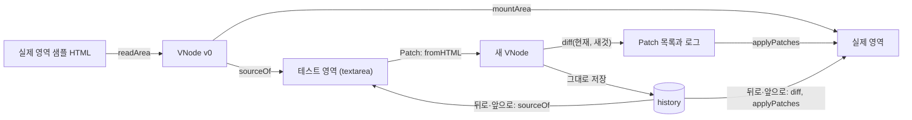

# 검증 페이지와 State History

> 이 문서를 읽으면 Patch, 뒤로가기, 앞으로가기가 두 영역과 히스토리를 어떻게 바꾸는지 알고, `src/app.ts`를 구현하고 시연까지 할 수 있어요.

| 항목 | 내용 |
|---|---|
| 상태 | 공통 형식 합의 완료 ([vnode-spec.md](vnode-spec.md)). 페이지 경로와 화면 배치는 2026-11-09에 정했어요([화면](#화면)) |
| 다루는 요구사항 | R1-3, R1-4, R1-5, R1-6, R1-7, R3-3 |
| 관련 이슈 | #7 |
| 소스 파일 | `src/app.ts`, `src/app.test.ts`, `verify.html`, `src/verify-page.ts`, `src/verify-page.test.ts` |

## 화면 흐름



## 함수

`Editor`는 `{ value: string }`이에요. `HTMLTextAreaElement`가 이 모양이라 그대로 넘기고, 테스트에서는 일반 객체를 넘겨요.

| 함수 | 입력 | 출력 | 하는 일 |
|---|---|---|---|
| `load(real, editor)` | `real: Element`: 실제 영역. `editor: Editor` | 없음 | 아래 표의 "로드" |
| `onPatch(real, editor)` | 위와 같음 | `Patch[]` | 아래 표의 "Patch". 실패하면 복구 후 예외를 다시 던져요 |
| `canGo(delta)` | `delta: -1 \| 1` | `boolean` | 그 방향으로 이동할 수 있는지. 버튼 활성화에 써요 |
| `go(real, editor, delta)` | `real`, `editor`, `delta` | `Patch[]`, 이동할 수 없으면 `null` | 아래 표의 "뒤로·앞으로". 실패하면 복구 후 예외를 다시 던져요 |
| `countMutations(target, fn)` | `target: Node`, `fn: () => T` | `{ result: T, mutations: number }` | `fn`이 일으킨 DOM 변경 기록 수를 세요. 감시 옵션은 `{ childList: true, attributes: true, characterData: true, subtree: true }`예요 |

`history`는 `{ stack: VNode[], index: number }`이고 `src/app.ts`가 `export const`로 하나만 둬요. 처음 값은 `{ stack: [], index: -1 }`이고, `load`가 필드를 바꿔 초기화해요. 테스트에서 직접 읽을 수 있어요.

| 동작 | 실제 영역 | 테스트 영역 | `history` |
|---|---|---|---|
| 로드 | 샘플 HTML을 읽고 엔진이 한 번 새로 그려요 | `sourceOf(v0)` | `stack: [v0]`, `index: 0` |
| Patch | `diff(현재, fromHTML(editor.value))`를 적용 | `sourceOf(새 VNode)`로 다시 채워요 | 현재 이후를 잘라내고 새 VNode를 추가 |
| 뒤로·앞으로 | `diff(현재, 목표)`를 적용 | `sourceOf(목표)` | `index`만 이동 |

**각 규칙의 이유**

- **로드 때 새로 그려요.** 원래 DOM에는 VNode에서 버린 공백 텍스트 노드가 있어 경로가 어긋나요. 대가는 로드 때 1회 전체 렌더예요. 이후 갱신은 전부 Diff와 Patch로 해요.
- **Patch 후 textarea를 다시 채워요.** 파서는 잘못된 중첩을 고쳐 읽어요. `<p>a<div>b</div></p>`는 `p`가 닫히고 `div`가 형제가 되며 빈 `p`가 하나 더 생겨요. 다시 채우면 실제로 적용된 구조를 볼 수 있어요.
- **기준은 항상 `history`예요.** 이전 VNode를 textarea에서 다시 만들지 않아요. 실제 영역의 DOM은 항상 `history.stack[history.index]`와 같아요.
- **복제하지 않아요.** VNode는 불변이고 DOM 참조가 없어서 히스토리가 같은 객체를 그대로 저장해요.
- **변경 횟수:** `MutationObserver`의 `takeRecords`로 그 자리에서 꺼내므로 비동기로 기다리지 않아요. `fn`이 예외를 던져도 `finally`로 `disconnect`해요. 노드 추가·제거는 `childList`, 속성은 `attributes`, 독립 텍스트 VNode의 `TEXT`는 `characterData`로 잡혀요. 깊은 노드를 보려면 `subtree`가 필요해요. `MutationObserver`는 전역이 아니라 `target.ownerDocument.defaultView`에서 꺼내요([DOM 전역 규칙](virtual-dom.md#dom-전역-규칙)).

R1-4의 "테스트 영역을 그려요"는 textarea에 HTML 소스를 보여 주는 것으로 해석했어요. 태그와 속성 변경까지 다섯 경우를 모두 시연할 수 있기 때문이에요. Notion 결정 D로 확정했어요.

## Patch 실패

Patch 도중 예외가 나면 실제 영역이 절반만 바뀐 채 남아 이후 경로가 어긋나요. 그래서 `onPatch`와 `go`는 이렇게 처리해요.

0. `onPatch`는 적용 전에 `createDOM(새 VNode)`로 그릴 수 있는지 확인해요. 실패하면 실제 영역을 건드리지 않고 예외를 그대로 던져요. 그래서 `history`의 모든 스냅샷은 2번 복구에서 다시 그릴 수 있어요. 확인한 범위에서는 파서가 받아들인 HTML이 모두 그려지지만([patch.md](patch.md#예외)), 확인하지 않은 브라우저를 위해 남겨요.
1. `applyPatches`를 `try`로 감싸요.
2. 예외가 나면 `mountArea(real, 현재 VNode)`로 실제 영역을 복구하고 같은 예외를 다시 던져요.
3. `history`는 바꾸지 않아요. `editor.value`도 바꾸지 않아 사용자가 입력을 고칠 수 있어요.
4. 버튼 핸들러가 예외를 잡아 화면에 메시지를 보여 줘요.

복구는 전체를 새로 그리므로 사용자가 실제 영역에서 바꾼 폼 상태는 VNode 값으로 돌아가요.

```text
상태: 실제 영역의 select가 텍스트 노드로 바뀌어 VNode와 어긋남
입력: h2를 "나리 프로필"로, select의 name을 "t"로 바꾼 소스
결과: h2 TEXT가 적용된 뒤 PROPS에서 "PROPS 대상이 요소가 아니에요" 전달,
      실제 영역은 복구되어 history의 현재 VNode와 같음, history는 그대로, textarea는 입력 그대로
```

## 샘플 HTML

실제 영역의 초기 내용이에요. 3단 중첩, 여러 속성, 텍스트와 요소가 섞인 자식, key 목록, 폼 상태를 담아요.

```html
<section id="profile" class="card">
  <h2>프로필</h2>
  <p>이름: <b>정글러</b> · 기수: <i>13기</i></p>
  <ul class="todo">
    <li data-key="vdom">Virtual DOM</li>
    <li data-key="diff">Diff</li>
    <li data-key="patch">Patch</li>
  </ul>
  <label><input type="checkbox" checked /> 알림 받기</label>
  <select name="track">
    <option value="fe">프론트</option>
    <option value="be" selected>백엔드</option>
  </select>
</section>
```

## 시연 시나리오

화면에 Patch 로그(`formatPatches`)와 DOM 변경 횟수(`countMutations`)를 함께 띄워요. 바뀐 곳만 건드렸다는 것을 데이터와 숫자로 보여 주기 위해서예요. 아래 값은 실행해서 확인했고, 단계를 이어서 진행한 결과예요.

| 단계 | textarea에서 할 일 | Patch | DOM 변경 |
|---|---|---|---|
| 1 | 정글러 → 나리 | `TEXT [0, 1, 1]` | 1 |
| 2 | `class="card"` → `class="card dark"` | `PROPS [0]` | 1 |
| 3 | `</section>` 앞에 `<p>추가</p>` | `CREATE [0]` `index: 5` | 1 |
| 4 | `<h2>프로필</h2>` 줄 삭제 | `REPLACE [0, 0]`~`[0, 4]` 5개 + `REMOVE [0, 5]` | 6 |
| 5 | `<b>나리</b>` → `<u>나리</u>` | `REPLACE [0, 0, 1]` | 1 |
| 6 | Patch 항목을 목록 맨 위로 | `MOVE [0, 1]` `from: 2`, `to: 0` | 2 |
| 7 | 뒤로가기 6번 | 단계마다 `diff`, `applyPatches` | 처음 상태. 체크박스 켜짐, `select`는 백엔드 |

- 4단계는 위치 비교의 한계를 보여 줘요. 맨 앞 형제가 사라지자 뒤 형제가 당겨져 5개가 모두 `REPLACE`되고 마지막 자리는 `REMOVE`돼요. `data-key`를 붙인 목록을 옮긴 6단계는 이동 1건으로 끝나요. 둘을 나란히 보이면 key가 왜 필요한지 설명돼요.
- 6단계가 2건인 이유는 이동이 떼어 내기와 넣기, 두 번의 DOM 변경이기 때문이에요.
- key 비교를 축소 구현하면 6단계 값이 바뀌어요([축소 구현](phase-1-plan.md#key-비교-단계-9)).

## 화면

`npm run build` 후 저장소 루트에서 로컬 서버를 열고 `/verify.html`로 들어가요. 페이지는 `./dist/verify-page.js`의 `startPage(document)`를 불러요.

```text
테스트 케이스 #cases: [1. 텍스트] [2. 속성] … [다양한 태그] …
#case-note  고른 케이스의 기대 결과
┌──────────────────┬──────────────────┐
│ 실제 영역 #real   │ 테스트 영역       │
│                  │ #monaco (#editor)│
└──────────────────┴──────────────────┘
[Patch #patch] [뒤로가기 #back] [앞으로가기 #forward]  DOM 변경 #mutations
#error  오류 메시지
#log    Patch 로그
```

| `id` | 요소 | 내용 |
|---|---|---|
| `cases` | `nav` | [테스트 케이스](#테스트-케이스-목록) 버튼을 `start`가 채워요 |
| `case-note` | `p` | 마지막으로 누른 케이스의 이름과 기대 결과 |
| `real` | `div` | 실제 영역. 처음에는 [샘플 HTML](#샘플-html)을 담아요 |
| `editor` | `textarea` | 테스트 영역. Monaco를 불러오면 숨겨요 |
| `monaco` | `div` | [Monaco](#테스트-영역-에디터)를 그릴 자리. 처음에는 `hidden`이고 Monaco를 불러오면 보여요 |
| `patch`, `back`, `forward` | `button` | `onPatch`, `go(-1)`, `go(1)`. 이동 버튼은 `canGo`가 `false`면 `disabled` |
| `mutations` | `output` | 마지막으로 성공한 동작의 `countMutations` 값 |
| `error` | `p` | 마지막 동작의 예외 메시지. 성공하면 비워요 |
| `log` | `pre` | 마지막으로 성공한 동작의 Patch를 한 줄에 하나씩. 각 줄은 `formatPatches([patch])`에서 바깥 `[]`를 뗀 JSON이에요. Patch가 없으면 `변경 없음` |

- 동작이 실패하면 `#error`만 바꾸고 로그와 변경 횟수는 그대로 둬요. 실패한 동작의 변경 횟수는 복구까지 섞여서 의미가 없어요.
- 이동할 수 없을 때 버튼은 비활성이라 `go`의 `null`은 화면에서 생기지 않아요. 생기면 `#error`, `#log`, `#mutations` 모두 이전 값 그대로 둬요.
- 너비가 720px보다 좁으면 두 영역을 위아래로 쌓아요.

### 테스트 케이스 목록

시연과 브라우저 확인을 손으로 입력하지 않고 할 수 있게 케이스를 묶음별 버튼으로 둬요. PR #45–#56 본문의 엣지 케이스와 리뷰에서 지적받은 케이스 중 테스트 영역 입력으로 만들 수 있는 것을 모았어요. 버튼은 테스트 영역의 내용만 바꾸고 Patch는 하지 않아요. 바뀐 내용을 보고 Patch를 누르게 하기 위해서예요. 케이스는 `src/verify-cases.ts`의 `CASES`예요.

- **한 단계 케이스**: 누르면 테스트 영역을 바꾸고 `#case-note`에 기대 결과를 써요.
- **두 단계 케이스**(`before`가 있음): 현재 스냅샷의 `sourceOf`가 `sourceOf(fromHTML(before))`와 다르면 `before`를 채우고 `(1/2)`를 써요. 같으면 바뀐 상태를 채우고 `(2/2)`와 기대 결과를 써요. 그래서 "누르기 → Patch → 다시 누르기 → Patch" 순서로 써요.
- 시연 1–6은 바로 앞 단계를 Patch한 뒤에 눌러요. 바꿀 문자열이 없으면 내용을 그대로 두고 `#error`에 "적용할 곳이 없어요"를 써요. 다른 케이스를 누르면 `#error`를 비워요.

| 묶음 | 버튼 | 바뀌는 입력 | 기대 결과 |
|---|---|---|---|
| 시연 | 1–6 | [시연 시나리오](#시연-시나리오)의 1–6단계 | 시나리오 표와 같아요 |
| 시연 | 처음 샘플 | 로드 때의 `sourceOf(v0)` | 처음 상태로 돌아가는 Patch |
| Patch | 형제 여러 개 삭제 | key 목록 `a b c d` → `a d` | `REMOVE [0, 2]`, `[0, 1]`, DOM 변경 2 |
| Patch | 이동 + 삭제 | `a b c d` → `c a` | `REMOVE` 2개 + `MOVE`, DOM 변경 4 |
| Patch | 텍스트 → 요소 | `<p>a</p>` → `<p><b>a</b></p>` | `TEXT`(빈 값) + `CREATE`, DOM 변경 2 |
| Patch | 요소 → 텍스트 | `<p><b>a</b><i>b</i></p>` → `<p>ab</p>` | `REMOVE` 2개가 `TEXT`보다 먼저, DOM 변경 3 |
| Patch | 요소 → 비어 있음 | `<p><b>a</b></p>` → `<p></p>` | `REMOVE`, DOM 변경 1 |
| Patch | 비어 있음 → 텍스트 | `<p></p>` → `<p>a</p>` | `TEXT`, DOM 변경 1 |
| Patch | 입력한 textarea | `<textarea>메모</textarea>` → `할 일` | `TEXT`, DOM 변경 1. 실제 영역 textarea에 입력한 값도 `할 일`이 돼요 |
| 위치 비교 | 텍스트 ↔ 요소 | `<b>x</b>a` → `<b>x</b><i>a</i>` | `REPLACE [1]`, DOM 변경 1 |
| 위치 비교 | 속성 값만 다름 | `<p id="a" title="x">` → `<p id="b">` | `PROPS` 하나, 속성마다 DOM 변경 1이라 2 |
| key 비교 | key만 다름 | `a:x` → `b:x` | `REMOVE` + `CREATE`, DOM 변경 2 |
| key 비교 | 같은 key, 다른 태그 | `li` `b` → `p` `b` | `REMOVE` + `CREATE`, DOM 변경 2 |
| key 비교 | 옮긴 노드의 내용 변경 | `a b c` → `c(내용 C) a b` | `TEXT [0, 2]`가 `MOVE`보다 먼저, DOM 변경 3 |
| key 비교 | key 있음·없음 섞임 | `a x b` → `b x a`(`x`는 key 없음) | `MOVE` 2개, DOM 변경 4 |
| key 비교 | 중복 key | `a b` → `b a a` | 콘솔 경고 1번, `MOVE` + 뒤의 `a`만 `CREATE`, DOM 변경 3 |
| key 비교 | 공통 구간의 중복 key | `x(1) x(2) z` → `z x(1)` | 경고 없음, 두 번째 `x`는 `REMOVE`, `z`는 `MOVE`, DOM 변경 3 (PR #50 리뷰) |
| key 비교 | 빈 data-key | `""` `b` → `b` `""` | `data-key=""`도 key라 `MOVE` 1개, DOM 변경 2 (PR #48 리뷰) |
| 읽기·속성 | file 입력 type 변경 | `<input type="text" value="a">` → file input 두 개 | 첫 input은 `PROPS`(type → file), 둘째는 `CREATE`. 오류 없음, DOM 변경 2 (PR #52 리뷰의 복구 실패 재현) |
| 읽기·속성 | 이상한 속성 이름 | `<p x"y="1" =z="2">a</p>` | `x"y`는 그대로 그려지고 `=`로 시작하는 속성은 버려져요. 오류 없음 (PR #52 리뷰) |
| 읽기·속성 | 새 option + select 값 | option 하나 → 둘(`B` 선택) | `PROPS` + `CREATE`, DOM 변경 2. select 값이 `b` |
| 읽기·속성 | class 삭제 | `<p class="x">` → `<p>` | `PROPS` remove `class`, DOM 변경 1. 빈 `class=""` 없음 |
| 읽기·속성 | 주석·&nbsp; | `<p>a<!-- 주석 -->b&nbsp;c</p>` | 주석은 버리고 양옆을 합쳐요. `&nbsp;`는 U+00A0 문자로 남아요 |
| 읽기·속성 | key와 data-key | `<li key="x" data-key="y">` | `key` 속성은 버려지고 `data-key`가 key |
| 읽기·속성 | style·checked·progress | `style` 문자열, `checked=""`, `progress value="abc"` | 오류 없음, 체크박스 켜짐 |
| 기타 | 다양한 태그 | [다양한 태그 HTML](virtual-dom.md#다양한-태그) | 오류 없음. `range` 250, 체크박스 켜짐, `select` Y, `output` 안 `b`는 "출력" |
| 기타 | 잘못된 중첩 | `<p>a<div>b</div></p>` | 파서가 고친 구조로 비교하고 테스트 영역을 다시 채워요 |
| 기타 | script·on* | `<p onclick>`과 `<script>` | 둘 다 버려져 테스트 영역에서도 사라져요 |
| 기타 | 변경 없음 | 그대로 | Patch 없음, 히스토리에는 추가 |
| 기타 | 비우기 | 빈 문자열 | 루트만 남아요 |

key 목록은 `<ul>` 안의 `<li data-key="…">`예요. `c(내용 C)`처럼 적지 않으면 내용은 key와 같아요.

페이지로 보여 줄 수 없는 엣지 케이스(VNode 정규화, `Object.freeze`, 999겹 중첩, `lis`, 어긋난 경로, 컴포넌트 VNode, `checked`에 객체 값(PR #49 리뷰), 실제 영역이 VNode와 어긋난 뒤의 복구와 `go` 실패(PR #52 리뷰), 무작위 입력)는 각 `*.test.ts`에서만 확인해요. HTML 입력으로는 그런 값이나 상태를 만들 수 없어요.

### 테스트 영역 에디터

테스트 영역은 VS Code의 에디터인 [Monaco](https://github.com/microsoft/monaco-editor)로 보여요. 문법 강조와 태그 자동완성(제안 목록)을 쓰기 위해서예요. [과제 제한](../PLANNING.md)(HTML, CSS, TypeScript만 사용)의 예외로, 2026-11-10에 담당자(박준호)가 정했어요. Virtual DOM, Diff, Patch와 히스토리에는 쓰지 않아요.

| 항목 | 내용 |
|---|---|
| 불러오기 | `verify.html`이 jsdelivr의 `monaco-editor@0.52.2/min/vs/loader.js`를 `defer`로 불러요. npm 의존성은 추가하지 않아요. 번들러 없이 `tsc`만 쓰기 때문이에요 |
| 무결성 | `loader.js`에는 SRI(`integrity`)를 붙여요. 로더가 나중에 불러오는 `editor.main.js`와 워커는 SRI로 보호하지 못해요. 로컬 시연 페이지라 버전 고정으로 받아들여요 |
| 버전 | 0.52.2로 고정해요. 0.53 이후는 빌드 구조가 바뀌어 CDN에서 워커를 불러오는 방식이 확인되지 않았어요 |
| 워커 | 다른 출처의 워커는 바로 만들 수 없어서, `MonacoEnvironment.getWorkerUrl`이 CDN의 `workerMain.js`를 `importScripts`하는 `data:` URL을 돌려줘요 |
| `Editor` 연결 | `getValue`, `setValue`로 `value`를 읽고 쓰는 객체를 `start(doc, editor)`에 넘겨요. `app.ts`는 바꾸지 않아요 |
| 닫는 태그 | Monaco는 HTML 닫는 태그를 자동으로 넣지 않아요. 내용 변경이 `>` 한 글자면 `closingTagFor`로 닫는 태그를 구해 `executeEdits`로 커서 뒤에 넣고 커서는 그 앞에 둬요. `<li>`를 치면 `<li>\|</li>`가 돼요(`\|`는 커서). [빈 요소](https://html.spec.whatwg.org/multipage/syntax.html#void-elements)와 `/>`로 끝난 태그, 닫는 태그, 주석은 건너뛰어요. 되돌리기·다시 실행과 `setValue`로 바뀐 내용에는 반응하지 않아요. 넣기 전에 `pushUndoStop`을 불러서 Ctrl+Z 한 번에 넣은 닫는 태그만 지워져요. 한계: 이미 닫힌 태그의 `>`를 지웠다가 다시 치거나, 속성 값·주석 안에서 `>`를 쳐도 닫는 태그가 들어가요. 막으려면 HTML을 파싱해야 해서 하지 않았어요 |
| 불러오기 실패 | 로더가 없거나(`require`가 함수가 아님) 에디터 모듈을 못 불러오거나 `create`가 던지거나 10초(`MONACO_TIMEOUT_MS`) 안에 끝나지 않으면 textarea로 `start(doc)`를 불러요. `start`는 한 번만 불러요 |

- Monaco를 불러오기 전에는 버튼에 핸들러가 없어요. 늦어도 10초 뒤에는 동작해요.
- 인터넷 연결이 없으면 textarea로 동작해요.

## 엣지 케이스

| 상황 | 처리 |
|---|---|
| 내용을 바꾸지 않고 Patch | Patch는 `[]`이지만 `history`에 항목이 추가되고 앞으로가기 기록이 잘려요. 주석, `pre`, `textarea`, `key` 속성이 있어도 `[]`예요([소스 왕복](virtual-dom.md#검사)) |
| 히스토리 끝에서 이동 | `go`는 `null`을 돌려주고 아무것도 하지 않아요. 버튼은 `canGo`로 비활성화해요 |
| 뒤로간 뒤 Patch | 앞으로가기 기록을 잘라내요 |
| textarea를 비우고 Patch | 루트만 남아요. 영역 자체는 그대로예요 |
| 잘못된 중첩 입력 | 파서가 고쳐 읽은 구조로 비교하고 textarea도 그 결과로 채워요 |
| `<script>`, `on*` 입력 | 읽을 때 버려져 textarea에서도 사라져요 |
| 사용자가 실제 영역의 폼 값을 바꿈 | VNode에 없는 상태라 비교 대상이 아니에요. 그 노드가 교체되거나 복구되면 VNode 값으로 돌아가요. `textarea`는 그 칸에 `TEXT`가 와도 VNode 값으로 돌아가요([patch.md](patch.md#textarea의-text)) |

## 테스트

`src/app.test.ts`에서 `node:test`와 `jsdom`으로 확인해요. 구현과 테스트는 [DOM 전역 규칙](virtual-dom.md#dom-전역-규칙)을 따라요.

- 히스토리: 로드 → Patch → Patch → 뒤로 → 앞으로 → 뒤로 → Patch 순서로 실제 영역, textarea 내용, `canGo`, 앞으로가기 기록 잘림, 스냅샷이 같은 객체인지.
- 시나리오: 위 표의 여섯 단계가 각각 해당 Patch와 DOM 변경 횟수를 내고 자가 검사를 통과하는지. 7단계 후 체크박스와 `select` 상태까지 처음과 같은지. 6–7단계는 key 비교가 필요해서 [단계 10](phase-1-plan.md#순서)에서 추가해요.
- 실패 복구: 위 입력에서 예외가 전달되고, `history`, 실제 영역, textarea가 위 결과와 같은지. 그 뒤 올바른 입력으로 Patch가 되는지.
- 잘못된 중첩: 입력 후 textarea가 다시 쓰이는지.

`start`와 `startPage`는 `src/verify-page.test.ts`에서 `verify.html`을 jsdom으로 읽어 확인해요. Monaco는 가짜 `require`와 가짜 에디터로 대신해요(불러오기 성공·실패, `create` 실패, 닫는 태그). 로드 직후 상태, Patch 후 로그와 변경 횟수, 뒤로가기·앞으로가기의 두 영역과 버튼 상태, 실패 후 오류 메시지와 다음 성공에서 지워짐, 요소가 없을 때의 `Error`예요.

브라우저 기능 테스트는 #7의 완료 조건이에요. 위 시나리오를 실제 브라우저에서 한 번 돌리고, [다양한 태그 HTML](virtual-dom.md#다양한-태그)을 textarea에 넣어 Patch한 뒤 화면을 눈으로 확인해요(R3-3).

2026-11-09에 Chrome에서 `verify.html`을 열어 실행했어요. textarea 값을 바꾸고 버튼의 `click()`을 부르는 스크립트로 돌렸어요.

확인한 것:

- 시연 시나리오 1–7단계의 Patch와 DOM 변경 횟수가 [위 표](#시연-시나리오)와 같았어요. 7단계 후 실제 영역의 `innerHTML`이 처음과 같았어요.
- 다양한 태그 HTML은 오류 없이 반영됐고, [그린 뒤 확인할 값](virtual-dom.md#다양한-태그) 네 개(`range`의 `value`, 체크박스의 `checked`, `select`의 `value`, `output` 안의 `b`)가 기대값과 같았어요.

아직 하지 않은 것:

- 사람이 화면을 직접 보는 확인(R3-3의 "눈으로 확인")
- 키보드로 직접 입력하기
- 다른 브라우저, 좁은 화면 배치

## 미정

Notion 문서에 없어서 정해야 하는 내용이에요. 담당자가 정해요. 정하지 않아도 지금 문서대로 구현할 수 있어요.

| 항목 | 이유 |
|---|---|
| 변경 없는 Patch의 저장 여부 | 지금은 R1-6대로 저장하지만, 앞으로가기 기록이 사라져요 |
| 바뀐 노드 강조 | 선택 항목으로 미뤘어요. 하려면 `applyPatches`가 고친 노드를 돌려줘야 해요 |
