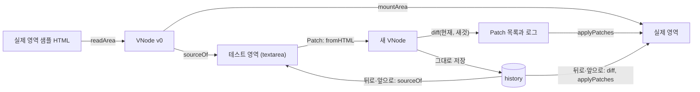

# 검증 페이지와 State History

> 이 문서를 읽으면 Patch, 뒤로가기, 앞으로가기가 두 영역과 히스토리를 어떻게 바꾸는지 알고, `src/app.ts`를 구현하고 시연까지 할 수 있어요.

| 항목 | 내용 |
|---|---|
| 상태 | 공통 형식 합의 완료 ([vnode-spec.md](vnode-spec.md)). 페이지 구성은 [미정](#미정)이에요 |
| 다루는 요구사항 | R1-3, R1-4, R1-5, R1-6, R1-7, R3-3 |
| 관련 이슈 | #7 |
| 소스 파일 | `src/app.ts`, `src/app.test.ts` |

## 화면 흐름



## 함수

`Editor`는 `{ value: string }`이에요. `HTMLTextAreaElement`가 이 모양이라 그대로 넘기고, 테스트에서는 일반 객체를 넘겨요.

| 함수 | 입력 | 출력 | 하는 일 |
|---|---|---|---|
| `load(real, editor)` | `real: Element`: 실제 영역. `editor: Editor` | 없음 | 아래 표의 "로드" |
| `onPatch(real, editor)` | 위와 같음 | `Patch[]` | 아래 표의 "Patch". 실패하면 복구 후 예외를 다시 던져요 |
| `canGo(delta)` | `delta: -1 \| 1` | `boolean` | 그 방향으로 이동할 수 있는지. 버튼 활성화에 써요 |
| `go(real, editor, delta)` | `real`, `editor`, `delta` | `Patch[]`, 이동할 수 없으면 `null` | 아래 표의 "뒤로·앞으로". 실패하면 복구 후 예외를 다시 던져요 |
| `countMutations(target, fn)` | `target: Node`, `fn: () => T` | `{ result: T, mutations: number }` | `fn`이 일으킨 DOM 변경 기록 수를 세요. 감시 옵션은 `{ childList: true, attributes: true, characterData: true, subtree: true }`예요 |

`history`는 `{ stack: VNode[], index: number }`이고 `src/app.ts`가 `export const`로 하나만 둬요. 처음 값은 `{ stack: [], index: -1 }`이고, `load`가 필드를 바꿔 초기화해요. 테스트에서 직접 읽을 수 있어요.

| 동작 | 실제 영역 | 테스트 영역 | `history` |
|---|---|---|---|
| 로드 | 샘플 HTML을 읽고 엔진이 한 번 새로 그려요 | `sourceOf(v0)` | `stack: [v0]`, `index: 0` |
| Patch | `diff(현재, fromHTML(editor.value))`를 적용 | `sourceOf(새 VNode)`로 다시 채워요 | 현재 이후를 잘라내고 새 VNode를 추가 |
| 뒤로·앞으로 | `diff(현재, 목표)`를 적용 | `sourceOf(목표)` | `index`만 이동 |

**각 규칙의 이유**

- **로드 때 새로 그려요.** 원래 DOM에는 VNode에서 버린 공백 텍스트 노드가 있어 경로가 어긋나요. 대가는 로드 때 1회 전체 렌더예요. 이후 갱신은 전부 Diff와 Patch로 해요.
- **Patch 후 textarea를 다시 채워요.** 파서는 잘못된 중첩을 고쳐 읽어요. `<p>a<div>b</div></p>`는 `p`가 닫히고 `div`가 형제가 되며 빈 `p`가 하나 더 생겨요. 다시 채우면 실제로 적용된 구조를 볼 수 있어요.
- **기준은 항상 `history`예요.** 이전 VNode를 textarea에서 다시 만들지 않아요. 실제 영역의 DOM은 항상 `history.stack[history.index]`와 같아요.
- **복제하지 않아요.** VNode는 불변이고 DOM 참조가 없어서 히스토리가 같은 객체를 그대로 저장해요.
- **변경 횟수:** `MutationObserver`의 `takeRecords`로 그 자리에서 꺼내므로 비동기로 기다리지 않아요. `fn`이 예외를 던져도 `finally`로 `disconnect`해요. 노드 추가·제거는 `childList`, 속성은 `attributes`, 독립 텍스트 VNode의 `TEXT`는 `characterData`로 잡혀요. 깊은 노드를 보려면 `subtree`가 필요해요. `MutationObserver`는 전역이 아니라 `target.ownerDocument.defaultView`에서 꺼내요([DOM 전역 규칙](virtual-dom.md#dom-전역-규칙)).

R1-4의 "테스트 영역을 그려요"는 textarea에 HTML 소스를 보여 주는 것으로 해석했어요. 태그와 속성 변경까지 다섯 경우를 모두 시연할 수 있기 때문이에요. Notion 결정 D로 확정했어요.

## Patch 실패

Patch 도중 예외가 나면 실제 영역이 절반만 바뀐 채 남아 이후 경로가 어긋나요. 그래서 `onPatch`와 `go`는 이렇게 처리해요.

1. `applyPatches`를 `try`로 감싸요.
2. 예외가 나면 `mountArea(real, 현재 VNode)`로 실제 영역을 복구하고 같은 예외를 다시 던져요.
3. `history`는 바꾸지 않아요. `editor.value`도 바꾸지 않아 사용자가 입력을 고칠 수 있어요.
4. 버튼 핸들러가 예외를 잡아 화면에 메시지를 보여 줘요.

복구는 전체를 새로 그리므로 사용자가 실제 영역에서 바꾼 폼 상태는 VNode 값으로 돌아가요.

```text
입력: <p>A</p><input type="file" value="a">
결과: InvalidStateError 전달, 실제 영역과 history는 Patch 전과 같음, textarea는 입력 그대로
```

## 샘플 HTML

실제 영역의 초기 내용이에요. 3단 중첩, 여러 속성, 텍스트와 요소가 섞인 자식, key 목록, 폼 상태를 담아요.

```html
<section id="profile" class="card">
  <h2>프로필</h2>
  <p>이름: <b>정글러</b> · 기수: <i>13기</i></p>
  <ul class="todo">
    <li data-key="vdom">Virtual DOM</li>
    <li data-key="diff">Diff</li>
    <li data-key="patch">Patch</li>
  </ul>
  <label><input type="checkbox" checked /> 알림 받기</label>
  <select name="track">
    <option value="fe">프론트</option>
    <option value="be" selected>백엔드</option>
  </select>
</section>
```

## 시연 시나리오

화면에 Patch 로그(`formatPatches`)와 DOM 변경 횟수(`countMutations`)를 함께 띄워요. 바뀐 곳만 건드렸다는 것을 데이터와 숫자로 보여 주기 위해서예요. 아래 값은 실행해서 확인했고, 단계를 이어서 진행한 결과예요.

| 단계 | textarea에서 할 일 | Patch | DOM 변경 |
|---|---|---|---|
| 1 | 정글러 → 나리 | `TEXT [0, 1, 1]` | 1 |
| 2 | `class="card"` → `class="card dark"` | `PROPS [0]` | 1 |
| 3 | `</section>` 앞에 `<p>추가</p>` | `CREATE [0]` `index: 5` | 1 |
| 4 | `<h2>프로필</h2>` 줄 삭제 | `REPLACE [0, 0]`~`[0, 4]` 5개 + `REMOVE [0, 5]` | 6 |
| 5 | `<b>나리</b>` → `<u>나리</u>` | `REPLACE [0, 0, 1]` | 1 |
| 6 | Patch 항목을 목록 맨 위로 | `MOVE [0, 1]` `from: 2`, `to: 0` | 2 |
| 7 | 뒤로가기 6번 | 단계마다 `diff`, `applyPatches` | 처음 상태. 체크박스 켜짐, `select`는 백엔드 |

- 4단계는 위치 비교의 한계를 보여 줘요. 맨 앞 형제가 사라지자 뒤 형제가 당겨져 전부 `REPLACE`돼요. `data-key`를 붙인 목록을 옮긴 6단계는 이동 1건으로 끝나요. 둘을 나란히 보이면 key가 왜 필요한지 설명돼요.
- 6단계가 2건인 이유는 이동이 떼어 내기와 넣기, 두 번의 DOM 변경이기 때문이에요.

## 엣지 케이스

| 상황 | 처리 |
|---|---|
| 내용을 바꾸지 않고 Patch | Patch는 `[]`이지만 `history`에 항목이 추가되고 앞으로가기 기록이 잘려요. 주석, `pre`, `textarea`, `key` 속성이 있어도 `[]`예요([소스 왕복](virtual-dom.md#검사)) |
| 히스토리 끝에서 이동 | `go`는 `null`을 돌려주고 아무것도 하지 않아요. 버튼은 `canGo`로 비활성화해요 |
| 뒤로간 뒤 Patch | 앞으로가기 기록을 잘라내요 |
| textarea를 비우고 Patch | 루트만 남아요. 영역 자체는 그대로예요 |
| 잘못된 중첩 입력 | 파서가 고쳐 읽은 구조로 비교하고 textarea도 그 결과로 채워요 |
| `<script>`, `on*` 입력 | 읽을 때 버려져 textarea에서도 사라져요 |
| 사용자가 실제 영역의 폼 값을 바꿈 | VNode에 없는 상태라 비교 대상이 아니에요. 그 노드가 교체되거나 복구되면 VNode 값으로 돌아가요. `textarea`는 그 칸에 `TEXT`가 와도 VNode 값으로 돌아가요([patch.md](patch.md#textarea의-text)) |

## 테스트

`src/app.test.ts`에서 `node:test`와 `jsdom`으로 확인해요. 구현과 테스트는 [DOM 전역 규칙](virtual-dom.md#dom-전역-규칙)을 따라요.

- 히스토리: 로드 → Patch → Patch → 뒤로 → 앞으로 → 뒤로 → Patch 순서로 실제 영역, textarea 내용, `canGo`, 앞으로가기 기록 잘림, 스냅샷이 같은 객체인지.
- 시나리오: 위 표의 여섯 단계가 각각 해당 Patch와 DOM 변경 횟수를 내고 자가 검사를 통과하는지. 7단계 후 체크박스와 `select` 상태까지 처음과 같은지. 6–7단계는 key 비교가 필요해서 [단계 10](phase-1-plan.md#순서)에서 추가해요.
- 실패 복구: 위 입력에서 예외가 전달되고, `history`, 실제 영역, textarea가 위 결과와 같은지. 그 뒤 올바른 입력으로 Patch가 되는지.
- 잘못된 중첩: 입력 후 textarea가 다시 쓰이는지.

브라우저 기능 테스트는 #7의 완료 조건이에요. 위 시나리오를 실제 브라우저에서 한 번 돌리고, [다양한 태그 HTML](virtual-dom.md#다양한-태그)을 textarea에 넣어 Patch한 뒤 화면을 눈으로 확인해요(R3-3). 아직 실행하지 않았어요.

## 미정

Notion 문서에 없어서 정해야 하는 내용이에요. 담당자가 정해요.

[단계 11](phase-1-plan.md#순서)을 시작하기 전에 정해요. `src/app.ts`의 함수는 먼저 구현할 수 있어요.

| 항목 | 이유 |
|---|---|
| 페이지 파일 경로와 시작 코드 | HTML 파일의 위치, `dist`의 어떤 파일을 불러 버튼에 연결할지 정의가 없어요 |
| 화면 배치와 요소 `id` | 두 영역, 버튼, 로그, 변경 횟수, 오류 메시지의 위치와 스타일 정의가 없어요 |

정하지 않아도 지금 문서대로 구현할 수 있어요.

| 항목 | 이유 |
|---|---|
| 변경 없는 Patch의 저장 여부 | 지금은 R1-6대로 저장하지만, 앞으로가기 기록이 사라져요 |
| 바뀐 노드 강조 | 선택 항목으로 미뤘어요. 하려면 `applyPatches`가 고친 노드를 돌려줘야 해요 |
